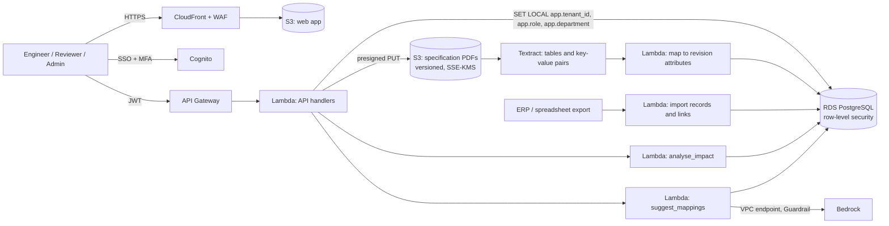

# Revwake: proposed AWS architecture

Status: this is a design, not a running system. The website and the prototype at `/app` are static front ends. `db/schema.sql` was loaded into PostgreSQL 16 and checked by `db/test_rls.sql` (tenant isolation, department scoping, review gates, append-only audit). The Lambdas in `backend/` are unit-tested and share fixtures with the prototype engine. Nothing is deployed. The services match the website's architecture section: Cognito, S3, Textract, Bedrock, Lambda and RDS for PostgreSQL.

## 1. Overview

| Concern | Decision |
|---|---|
| Identity | Cognito, optionally federated to the customer's IdP. Groups: `engineer`, `reviewer` (with a department claim), `admin`. |
| Authorisation | Handlers set `app.tenant_id`, `app.user_id`, `app.role` and `app.department` per transaction from the verified token. PostgreSQL row-level security enforces tenant isolation, department scoping for reviewers, no record text for admins, and admin-only audit reads. This mirrors the prototype's `src/app/actions.js`. |
| Revisions | The revised PDF goes to versioned S3. Textract extracts tables and key-value pairs, which are mapped to revision attributes and shown to the engineer before a change is created. |
| Records and links | Imported from ERP or spreadsheet exports. Links arrive unconfirmed unless the source system holds an explicit reference; engineers confirm them. |
| Analysis | `backend/lambdas/analyse_impact`: breadth-first search over confirmed links, superseded-value search, and the Complete / Review required / Mapping required / Unaffected classification. Same fixtures as the prototype. |
| AI | `backend/lambdas/suggest_mappings`: Bedrock Converse with a Guardrail. Only record text and specification text are sent, and the suggestion must quote both or it is dropped. |
| Gates | Enforced in the database as well as the API: dispositions need a reason, deviations need engineering approval, implementation evidence only applies to the right dispositions, closing is refused while anything is open, and closed changes are frozen (`check_change_close`). |
| Audit | `audit_event` is append-only via a trigger. Logical replication streams it to S3 with Object Lock for long-term retention. |

## 2. Data model

See `db/schema.sql`: `tenant`, `app_user`, `specification`, `spec_revision` (attributes as JSONB), `mfg_record`, `record_link` (confirmed flag with who and when), `eng_change`, `impact_result`, `review_task`, `ai_suggestion` and `audit_event`. The aggregate view `record_counts` serves the admin overview.

## 3. AI controls

1. AI only suggests mappings for records without a confirmed link. It never confirms a link, assigns a disposition or closes a change.
2. No customer names, quantities, prices or people are sent (`check_input`).
3. Both quotes must exist verbatim in the inputs, and malformed output fails closed.
4. Suggestions stay pending until an engineer decides. A rejection is stored with its reason as a “not dependent” decision.
5. A per-tenant switch; the confirmation rate is tracked on the admin overview.
6. Use Bedrock under terms that exclude customer content from training, and record this in the data-processing agreement.

## 4. Security and retention

KMS on RDS, S3 and logs; TLS 1.2+ with `verify-full` to RDS; RDS Proxy; private subnets; VPC endpoints for Bedrock and Textract; least-privilege IAM; WAF rate limits; and logs with IDs only. Default retention: closed changes and their tasks 10 years (customer quality records often require this; confirm per customer), source PDFs for the life of the specification plus 10 years, exports 30 days, audit 10 years.

## 5. Prototype vs production

| Area | Prototype | Production |
|---|---|---|
| Storage | Browser `localStorage` | RDS PostgreSQL + S3 |
| Revisions | Typed attribute values | PDF upload + Textract + engineer confirmation |
| Records | Seed data | ERP/spreadsheet import |
| Analysis | `src/app/engine.js` | `analyse_impact` (same fixtures) |
| AI | Word-overlap rule | Bedrock + Guardrail + quote validation |
| Auth | “Demo as” switch | Cognito + row-level security |

## 6. Not legal or quality-system advice

Customer and industry quality requirements (for example AS9100 or IATF 16949 change control) differ. Revwake records reviews and evidence; your quality system defines what is sufficient.
